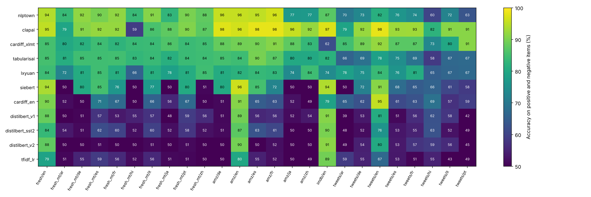
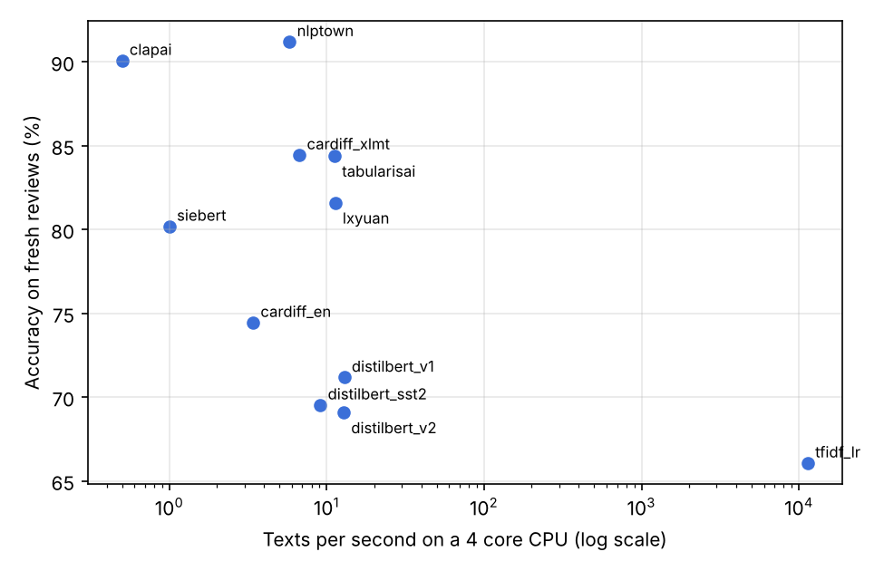

# Sentiment analyzer: which model to use outside movie reviews

Version 1 of this project fine tuned DistilBERT on IMDb movie reviews and reported 91.2% accuracy. Version 2 asks two questions. Was that number honest, and is a movie review model any use on product reviews, social media posts and languages other than English? To answer them it compares 11 models, including a clean retrain of the version 1 model, on 20,280 test texts in 10 languages.

Short answer: the 91.2% holds up, but the model is close to useless outside English. For reviews in any of the tested languages, the best choice here is `nlptown/bert-base-multilingual-uncased-sentiment`. For social media there is no clear winner, for reasons explained below.

All numbers come from `results/RESULTS.md`, which `python -m senti.report` builds from the saved predictions.

## What version 1 got wrong

The training notebook (`notebooks/02_training.ipynb`) passed the IMDb test set to the trainer as its evaluation set and kept the epoch with the best accuracy on it (`load_best_model_at_end=True`, `metric_for_best_model="accuracy"`). So the test set chose the model, and the same test set then reported the score.

Version 2 retrains the same model with the same recipe (DistilBERT base uncased, 3 epochs, batch 16, learning rate 0.00002, weight decay 0.01, 256 tokens), but holds out 2,500 of the 25,000 training reviews for validation and picks the epoch on those. Validation accuracy was 89.84%, 90.80% and 90.52% after epochs 1 to 3, so epoch 2 was kept. The test set was not touched until the end.

| Model | Accuracy on the full IMDb test set (24,801 reviews once exact duplicates are removed) |
|---|---|
| TF IDF with logistic regression | 89.5% (89.1 to 89.8) |
| Version 1 DistilBERT | 91.2% (90.8 to 91.5) |
| Version 2 DistilBERT, clean retrain | 91.4% (91.0 to 91.7) |

Brackets are 95% bootstrap intervals. The clean retrain scores the same as version 1 within noise, so choosing the epoch on the test set did not inflate the result in a way this test can detect. The method was still wrong, and version 2 fixes it.

## The test sets

| Set | What it is | Test texts | Languages |
|---|---|---|---|
| IMDb | Movie reviews, positive or negative only | 600 | English |
| Amazon 2022 to 2023 | Reviews written from January 2022 on, from 5 Amazon categories (subscription boxes, magazine subscriptions, gift cards, digital music, health and personal care), 300 each of 1 or 2 stars, 3 stars, and 4 or 5 stars | 900 | English |
| Same reviews, translated | The 900 reviews above machine translated with NLLB 200 (600M distilled) | 8,100 | Arabic, German, Spanish, French, Hindi, Italian, Japanese, Portuguese, Chinese |
| Tweets | Test split of Cardiff NLP's multilingual tweet sentiment dataset, 220 per label per language | 5,280 | Arabic, German, English, Spanish, French, Hindi, Italian, Portuguese |
| Amazon reviews (6 languages) | Test split of the older multilingual Amazon reviews corpus, 300 per label per language | 5,400 | German, English, Spanish, French, Japanese, Chinese |

Stars map to labels as 1 or 2 negative, 3 neutral, 4 or 5 positive. A separate set of validation rows (100 per label per language, 70 for tweets) was drawn the same way and used only to set each model's unsure band.

The Amazon 2022 to 2023 reviews and their translations are the "fresh" sets. They were written after most of these models were released, and they are almost absent from the one large training collection I could check (below). The ranking uses the mean over these two sets.

## Contamination: some models had already seen the test sets

clapAI's model is trained on a published collection that bundles many public sentiment datasets, including their test splits. I compared every test and validation text against that collection, word for word after normalising case and spaces. The matches:

* Amazon reviews (6 languages): 1,183 of 1,200 German texts, 1,198 Spanish, 1,191 French, 1,185 Japanese, 1,003 Chinese and 811 English.
* Tweets: between 708 (Arabic) and 853 (Spanish) of 870 per language.
* IMDb: 334 of 800.
* Amazon 2022 to 2023: 1 of 1,200 in English and at most 1 per translated language.

`lxyuan/distilbert-base-multilingual-cased-sentiments-student` was trained on one of the sources in that collection, so the same check applies to it for that source.

Taking out the matched texts changes clapAI's scores as follows:

| Set | Accuracy on all test texts | Accuracy on texts not in its training collection | Test texts not in the collection |
|---|---|---|---|
| Tweets | 90.0% | 85.6% | 437 of 5,280 |
| Amazon reviews (6 languages) | 96.3% | 91.7% | 477 of 5,400 |
| IMDb | 97.3% | 97.1% | 349 of 600 |

So clapAI's results on the two older public sets are inflated by about 4 to 5 points. The texts left over are a small and non random subset, so the cleaned numbers are rough. For lxyuan the overlap did not help: 74.1% on all tweets and 75.9% on unseen ones.

Two other models could not be checked. nlptown's model card says it was fine tuned on product reviews in English, Dutch, German, French, Spanish and Italian, but does not say where they came from or publish them. Cardiff NLP released both the multilingual tweet model and the tweet dataset used here; I used the dataset's test split but could not see what the model was trained on. That is why the ranking rests on the fresh sets.

## Results

Accuracy on positive and negative test items, with every model's output cut at 0.5:

| Model | Amazon 2022 to 2023 (English) | Same reviews, translated | Tweets | Amazon (6 languages) | IMDb | Fresh mean |
|---|---|---|---|---|---|---|
| nlptown | 94.3 | 88.1 | 71.4 | 89.4 | 87.2 | 91.2 |
| clapAI ModernBERT | 95.2 | 85.0 | 90.0 (seen) | 96.3 (seen) | 97.3 | 90.1 |
| Cardiff multilingual | 85.3 | 83.6 | 85.6 | 88.1 | 62.0 | 84.4 |
| tabularisai | 85.2 | 83.6 | 68.7 | 84.5 | 82.0 | 84.4 |
| lxyuan | 84.3 | 78.9 | 74.1 | 81.3 | 74.2 | 81.6 |
| SiEBERT (English) | 93.7 | 66.7 | 66.3 | 72.4 | 94.0 | 80.2 |
| Cardiff English (tweets) | 90.2 | 58.7 | 66.6 | 61.8 | 78.8 | 74.4 |
| Version 1 DistilBERT | 88.3 | 54.0 | 55.5 | 59.5 | 91.0 | 71.2 |
| DistilBERT SST 2 | 83.5 | 55.6 | 55.9 | 60.4 | 90.0 | 69.5 |
| Version 2 DistilBERT | 87.8 | 50.3 | 56.7 | 56.9 | 91.3 | 69.1 |
| TF IDF with logistic regression | 78.8 | 53.3 | 53.9 | 55.9 | 89.3 | 66.1 |



What this shows:

* The IMDb models (both DistilBERT versions and TF IDF) score 88% to 91% on IMDb and drop to chance, around 50%, on translated reviews. On English Amazon reviews they still reach 79% to 88%. Version 1's 91.2% says nothing about text outside English movie reviews.
* The English only models from the Hub (SiEBERT, Cardiff English, DistilBERT SST 2) lose 27 to 32 points between the English reviews and their translations. The multilingual models lose 2 to 10.
* nlptown and clapAI are level on fresh English reviews (94.3% and 95.2%, intervals 92.3 to 96.1 and 93.3 to 96.7). On the translated reviews nlptown is ahead, 88.1% against 85.0%, and the intervals do not overlap.
* clapAI fails on Hindi translations: 59.2%, because it calls 70% of the negative Hindi reviews positive. nlptown gets 83.8% on the same texts.
* nlptown was fine tuned on six European languages, yet scores 83.0% to 90.0% on the Arabic, Hindi, Japanese, Portuguese and Chinese translations.
* nlptown is weak on tweets (71.4%, and 60.5% on Hindi tweets) and on Japanese and Chinese product reviews (76.7% and 77.0%).

## Neutral and unsure

Real text is often mixed or neutral. Each model's output is turned into one score from 0 (negative) to 1 (positive), and any score inside a band is reported as unsure. The band is chosen on the validation rows to give the best macro F1 over negative, neutral and positive. On the fresh English reviews:

| Model | Unsure band | Macro F1, 3 labels | 3 star reviews marked unsure | 1, 2, 4 and 5 star reviews it commits on | Accuracy when it commits |
|---|---|---|---|---|---|
| clapAI ModernBERT | 0.23 to 0.76 | 74.4% | 64.3% | 80.5% | 98.3% |
| nlptown | 0.24 to 0.74 | 72.2% | 50.3% | 85.8% | 97.7% |
| Cardiff multilingual | 0.22 to 0.67 | 61.3% | 47.7% | 71.7% | 94.4% |
| SiEBERT | 0.01 to 0.99 | 54.9% | 6.3% | 98.0% | 94.6% |

The band is the practical tool here. When nlptown commits it is right 97.7% of the time on fresh English reviews and 94.7% on the translations, at the cost of sending about 1 in 7 English polar reviews (1 in 4 translated) to unsure. Neutral is still the hard part: the best models mark only half to two thirds of 3 star reviews as unsure. A 3 star rating is a loose stand in for neutral text, so some of those misses are reviews that read as clearly positive or negative.

## Speed and licences

Measured on one 4 core GitHub runner, the same 320 test texts (mean 366 characters) for every model, batch 16:

| Model | Texts per second | Parameters | Licence on the model page |
|---|---|---|---|
| nlptown | 5.8 | 167M | MIT |
| clapAI ModernBERT | 0.5 | 150M | Apache 2.0 |
| Cardiff multilingual | 6.7 | 278M | none listed |
| tabularisai | 11.2 | 135M | CC BY NC 4.0 (no commercial use) |
| lxyuan | 11.3 | 135M | Apache 2.0 |
| SiEBERT | 1.0 | 355M | none listed |
| Cardiff English | 3.4 | 125M | CC BY 4.0 |
| Version 2 DistilBERT | 12.8 | 67M | this project |
| TF IDF with logistic regression | 11,381.7 | | this project |



clapAI is about 12 times slower than nlptown on this CPU. I did not measure GPU speed. tabularisai's licence rules it out for commercial use whatever its accuracy, and SiEBERT and Cardiff multilingual list no licence, so check with their authors before using them in a product.

## Which model to use

* For product or service reviews in English or any of the tested languages, use nlptown with its unsure band of 0.24 to 0.74. It has the best fresh score (91.2% mean), an MIT licence and usable CPU speed.
* For English reviews where speed matters less, clapAI is just as accurate, holds back on more neutral reviews, and is Apache 2.0. It is the slowest model here on CPU. Check it on every language you need before using it beyond English; its Hindi result shows it can fail badly.
* For social media, Cardiff multilingual scores 85.6% on tweets and clapAI 85.6% on the tweets it had not seen. Neither result is fully clean, and Cardiff multilingual lists no licence, so test on your own posts before relying on either.
* Outside English movie reviews, do not use either DistilBERT version, DistilBERT SST 2 or TF IDF.

## Limits

* The translated set is machine translated. Translation mistakes count against the models, and translated text reads differently from text written in that language.
* The fresh reviews come from 5 Amazon categories. Restaurant, hotel or app reviews may behave differently.
* Star ratings are a proxy for sentiment. Some 1 star reviews are about delivery, not the product, and some 3 star reviews are clearly positive.
* Sarcasm, emoji only posts and code switching (two languages in one text) are not tested separately.
* Speed is one CPU type and one batch size.

## Files

* `src/senti/`: data loading and sampling (`data.py`), the 11 models and the mapping of their labels to negative, neutral and positive (`models.py`), prediction with sharding (`predict.py`), the clean retrain (`train.py`), metrics, unsure band and bootstrap (`metrics.py`), the contamination check (`overlap.py`), translation (`translate.py`), speed (`speed.py`) and the report (`report.py`).
* `results/RESULTS.md`: every table, with 95% intervals and accuracy by language for all 11 models. `results/predictions.parquet` holds every model's probabilities for every test text.
* `.github/workflows/benchmark.yml` and `finish.yml`: the runs that produced the results, on GitHub's CPU runners. Training saves its state and continues in a new job when it reaches the time limit.
* `app.py`: a Gradio demo with nlptown, Cardiff multilingual and clapAI and their unsure bands.
* `notebooks/`: the version 1 notebooks, kept as they were.

## Run it

```bash
pip install torch --index-url https://download.pytorch.org/whl/cpu
pip install -e ".[dev]"
python -m senti.data data
python -m senti.predict --model nlptown --data data --out preds
python -m senti.report --data data --preds preds --out results
pytest
```

The full benchmark runs on GitHub Actions; see `benchmark.yml` for the order of steps.
